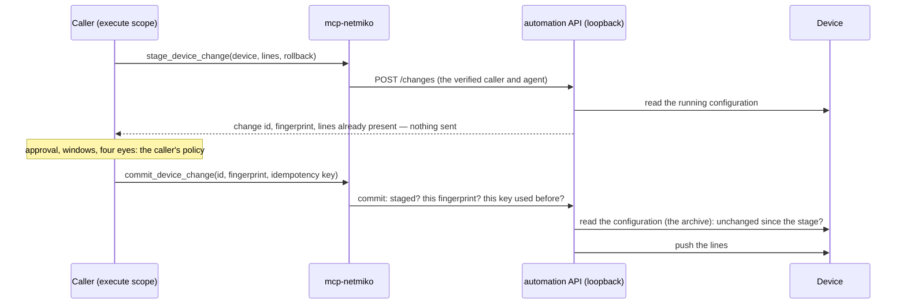

# Run device changes: stage, then commit once

With writes on (`make writes-on`, or `ai_platform.allow_write: true` in
`site.yml`), a caller with the **execute scope** can change device
configuration, always in two steps: it **stages** a change (nothing is sent),
then **commits** it once. Every action, done or refused, goes into the
execution log.

This stack **authenticates; it does not decide policy.** Who may ask for a
change, whether a person approved it, change windows, four eyes, which
interfaces carry management access: those belong to whatever drives the stack
(AgenticOps's Control, a pipeline, an operator). The stack guarantees how a
change is carried out, whoever asks.



## Who may run changes: the execute scope

| Credential | Scope |
|---|---|
| `MCP_AUTH_TOKEN` (shared) | read |
| `MCP_EXECUTE_TOKEN` (shared) | execute |
| A connected platform's token (`agenticops.yml` `platforms: <name>:`), from a client listed with `execute` there | execute |
| Any other valid token from that platform's provider | its `default_scope`: read, or none |

Execute covers read. Without an identity provider the stack runs on the two
tokens alone, so a standalone install can still run its own automation; keep the
execute token for the automation that changes devices, and give everything else
the read token. With a connected platform, give `execute` to its control
service's client only. A person's roles count for nothing: the client the token
was issued to (`azp`) decides. [connect-an-ai-platform.md](connect-an-ai-platform.md)

## What the stack guarantees

| Attempt | Result |
|---|---|
| A read-scope caller calls a change tool | refused: needs execute |
| Commit with another fingerprint than the stage returned | refused (409): commit exactly what was staged |
| Commit without an idempotency key | refused |
| Commit again with the **same** key (a retry after a timeout) | the first result; nothing is pushed again |
| Commit again with **another** key | refused (409): already committed |
| The device's configuration changed between stage and commit | refused (409) before anything is sent; the change is closed, stage it again |
| A protected line (`reload`, `write erase`, `no router bgp …`, users/AAA) | refused at staging, naming the line, before the device is read |
| Two commands in one line (a newline inside it) | refused at staging |
| Rollback a change that was not pushed, or twice | refused (409); the same key repeats the first answer |
| A push that fails, or a restart during a push | recorded as failed, never retried by itself |

"Changed" ignores what changes by itself: blank lines, comments (`!`, `#`, which
carry timestamps such as `! Last configuration change at …`) and IOS's
`ntp clock-period`. Protected lines are data:
[automation/changes/protected.yml](../../automation/changes/protected.yml).

## The tools (mcp-netmiko, with writes on)

| Tool | Scope | Does |
|---|---|---|
| `stage_device_change(device, lines, rollback?, source?)` | execute | checks the lines, reads the configuration, returns the id, the fingerprint and `already_present` (the dry run) |
| `commit_device_change(change_id, fingerprint, idempotency_key)` | execute | pushes once; archives the running configuration first |
| `rollback_device_change(change_id, idempotency_key)` | execute | pushes the declared rollback, once |
| `withdraw_device_change(change_id)` | execute | closes a staged change |
| `get_device_change(change_id)` | read | where a change stands: staged, committing, committed, withdrawn, failed |

None approves: there is nothing to approve here. A refusal comes back as the
tool's error, starting `refused:` with the reason.

## From this host

The automation API has no authentication of its own and trusts the caller
mcp-netmiko verified, so it is published on `127.0.0.1` only
(`AUTOMATION_BIND_IP`). On the host:

```bash
make change-stage DEV=router1 FILE=change.txt   # one command per line; prints the id and fingerprint
make change-commit ID=7f3a-c21e FP=<fingerprint>
make changes                                    # newest first
make change-events                              # the execution log
```

## Following changes

`/metrics` on the automation API (Prometheus scrapes it with the `automation`
job): `changes{state="…"}`, how many changes are in each state, and
`change_state{change_id="…",state="…"} 1`, one series per change staged in the
last 24 hours. Both name only ids and states, never the device, the lines or a
person.

## Moving from 1.x

1.x approved changes inside the stack. In 2.0.0 that is the connected
platform's: the approvals path (`/changes/{id}/approve` for people), the
change rights (`propose`, `approve`, `commit`, `commit any`), the windows,
fresh sign-in, four eyes, management interfaces, `WRITE_MODE=direct` with
`push_device_config`, and the `ChangeWaitingForApproval` alert are gone.
`install.py` stops on a `changes:` section or a role key in `site.yml`, saying
so. A change still waiting or approved under 1.x is closed when the automation
API starts (withdrawn, "closed by the move to 2.0.0"): stage it again.

## Check it

```bash
make mcp-check              # netmiko: 7 tools = changes on; 2 = read only
make changes
make change-events
```
